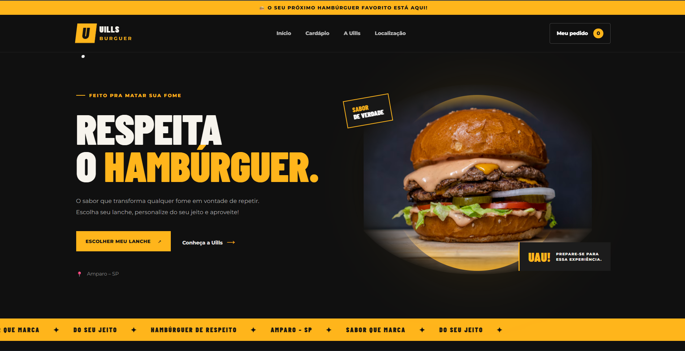
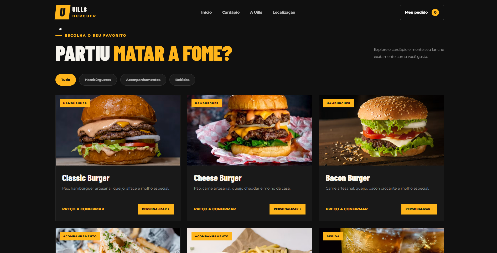
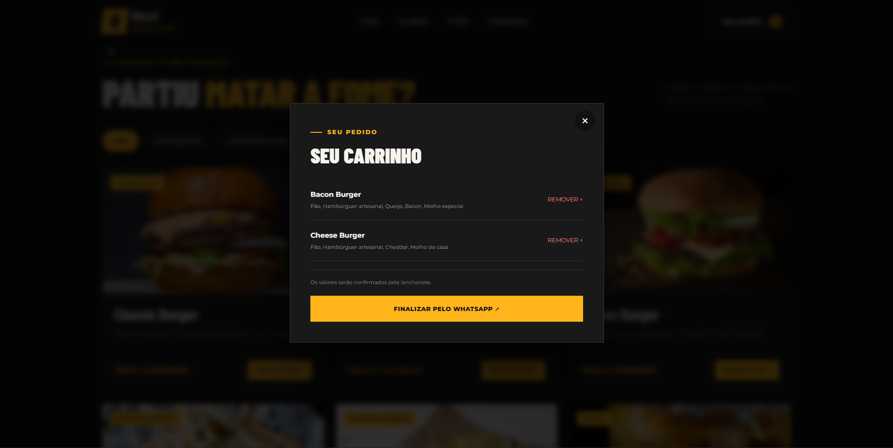

# 🍔 Uills Burguer

Site desenvolvido para a lanchonete **Uills Burguer**, localizada em Amparo - SP.

O projeto apresenta os produtos da lanchonete, permite personalizar os lanches, adicionar itens ao carrinho e realizar pedidos pelo WhatsApp.

## 🚀 Tecnologias utilizadas

- HTML5
- CSS3
- JavaScript

## 📌 Funcionalidades

- Página inicial com apresentação da lanchonete.
- Cardápio com categorias de produtos.
- Filtros para facilitar a busca pelos lanches.
- Personalização dos ingredientes.
- Adição e remoção de produtos do carrinho.
- Finalização do pedido pelo WhatsApp.
- Layout responsivo para celulares e computadores.
- Animações e efeitos visuais.

## 📂 Estrutura do projeto

```text
uills_burguer/
│
├── index.html
├── style.css
└── script.js
```

## 📍 Localização

**Uills Burguer**

Amparo - SP

## 📸 Capturas de tela

### Página inicial


### Cardápio


### Carrinho


---

Desenvolvido para a lanchonete **Uills Burguer** 🍔